# reel-level-site

**A Claude Code skill that rebuilds any website as a scroll experience worth filming.**

```
/reel-level-site https://your-brand.com
```

Claude reads the real site, finds one object from the brand's own world and turns the whole page into a trip with it. A railway becomes a train you ride down the page, station by station. Then it builds section by section against a craft floor that removes AI-slop patterns, audits every scroll position with screenshots, and records the finished site with a built-in demo mode.

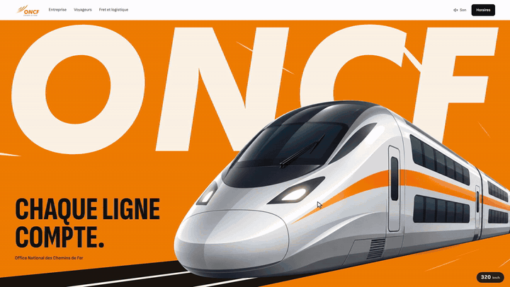

[▶ Watch the whole page](videos/oncf-full-scroll.mp4)

## Demos

Unofficial concepts built from the brands' public websites. Not affiliated with or approved by these organisations.

### ONCF, Morocco's national railway

The page is a journey from Tanger to the terminus. The train follows your scroll and each station opens a section.

<table>
<tr>
<td>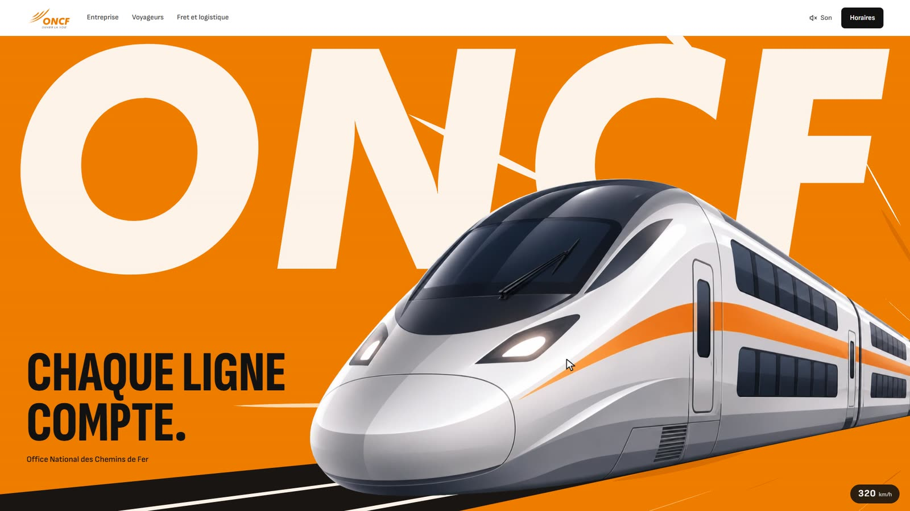<br><sub>Landing: fly through the O into the film</sub></td>
<td>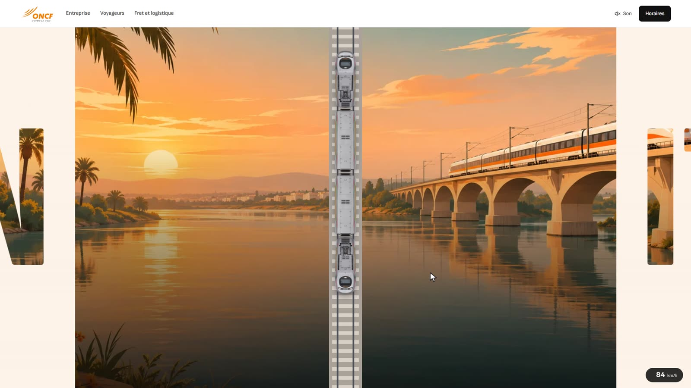<br><sub>Each stop is a real station nameboard</sub></td>
</tr>
<tr>
<td>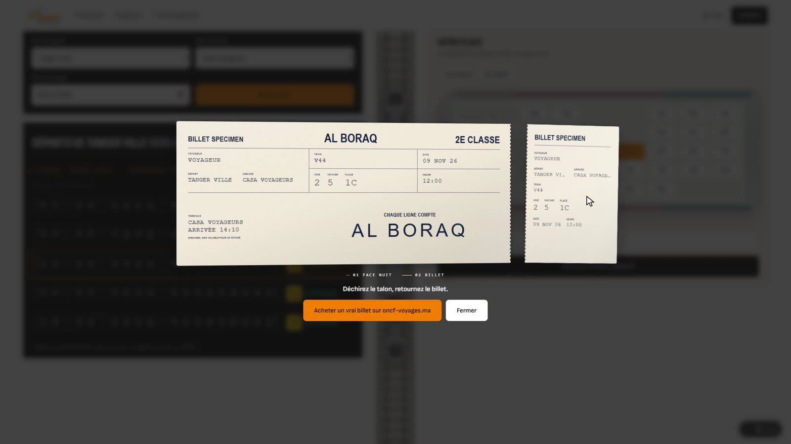<br><sub>Pick a train and a seat, tear the stub</sub></td>
<td>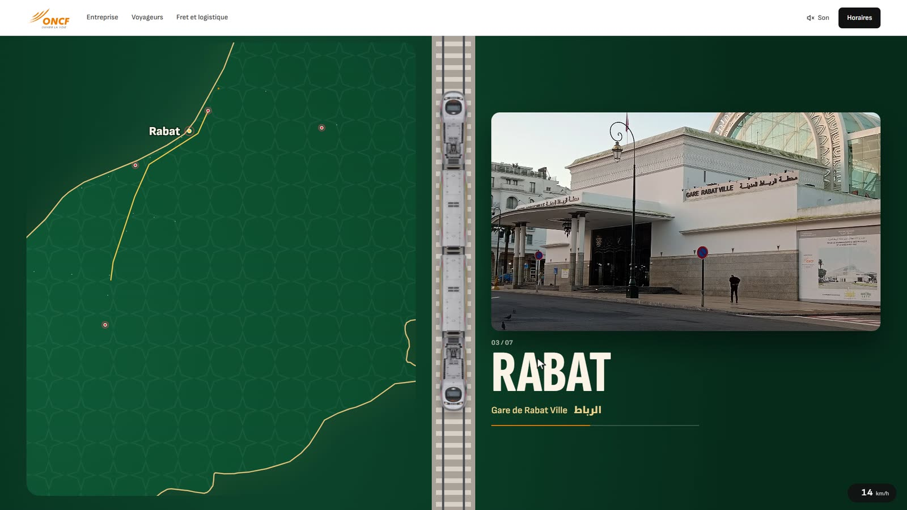<br><sub>Map tour, one real station per stop</sub></td>
</tr>
<tr>
<td>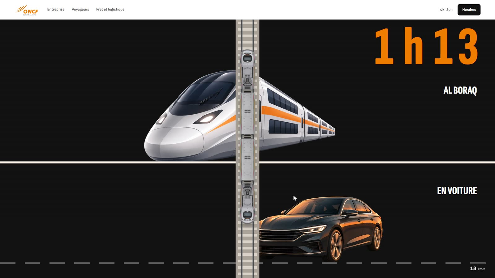<br><sub>Scroll runs the clock: train against car</sub></td>
<td>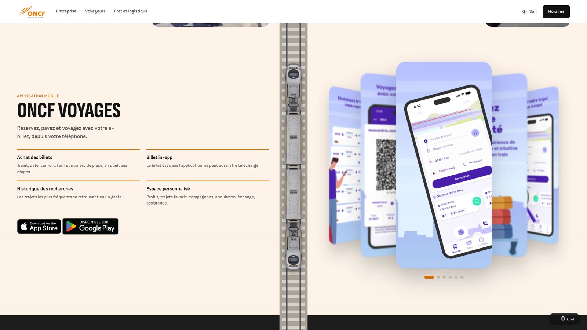<br><sub>The real app screens, in a coverflow</sub></td>
</tr>
<tr>
<td>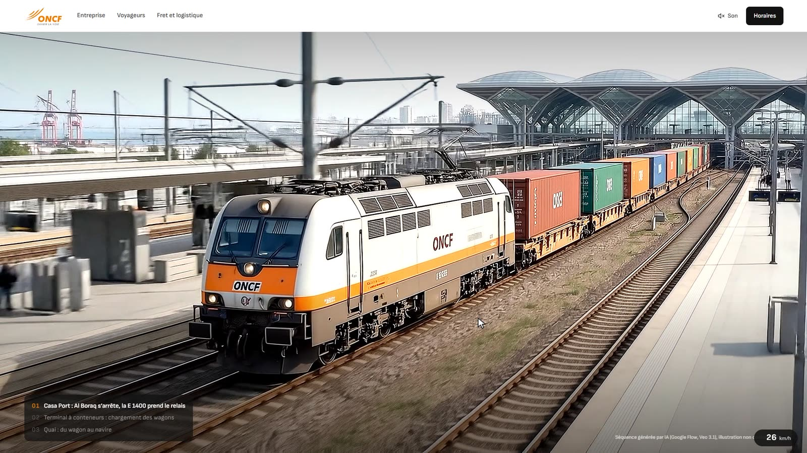<br><sub>A film scrubbed by the scroll</sub></td>
<td>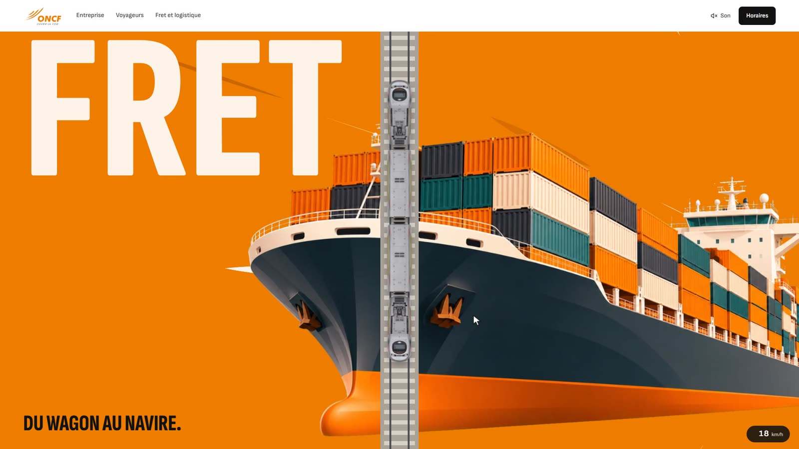<br><sub>Freight: the ship comes at you</sub></td>
</tr>
</table>

### FRMF, Morocco's football federation

The Atlas Lions' world: the star you dive through, the shirt in detail, the 2030 stadiums. [Live site](https://frmfv2.jerrary.com).

<table>
<tr>
<td>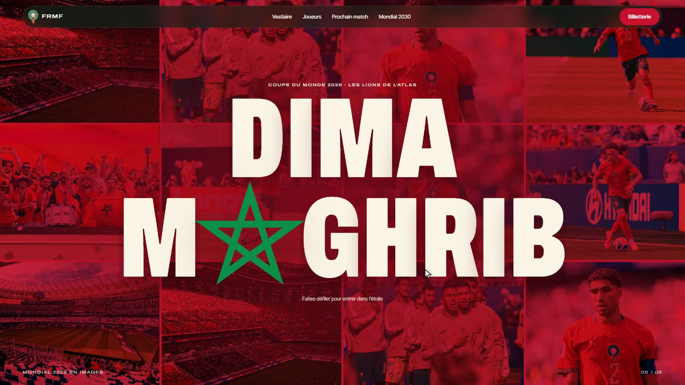</td>
<td>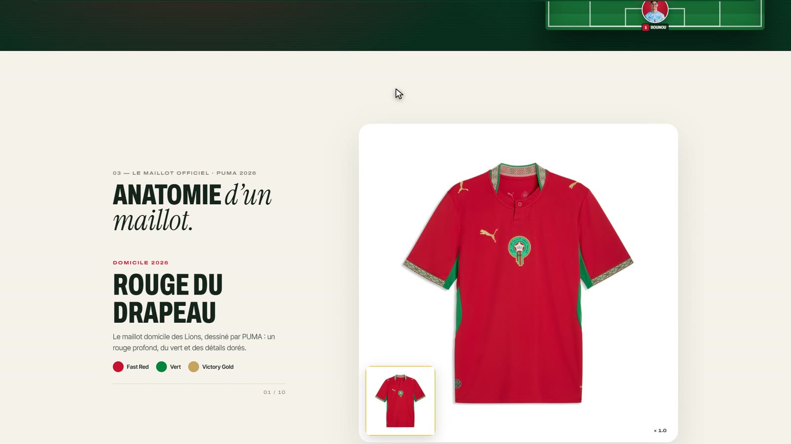</td>
<td>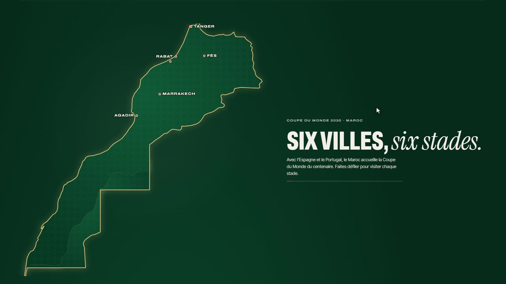</td>
</tr>
</table>

## Install

```bash
git clone https://github.com/OutOfAmine/reel-level-site ~/.claude/skills/reel-level-site
cd ~/.claude/skills/reel-level-site && npm install
```

Needs Node 18+ and Chrome, Edge or Chromium (or set `CHROME_PATH`). ffmpeg comes with `npm install`.

Then in Claude Code: `/reel-level-site <url>`, or just *"rebuild this site, make it reel level"*.

## What it does

1. **Reads the real site**: every section, real numbers, the official logo and colours. Nothing invented.
2. **Finds the spine**: one object from the brand's world becomes the whole page. You pick from two or three.
3. **Shows a first frame early**, so a weak idea dies before anything else gets built.
4. **Builds with the real tools** you name, like [21st.dev](https://21st.dev) or [ui-ux-pro-max](https://github.com/nextlevelbuilder/ui-ux-pro-max-skill).
5. **Holds a craft floor**: no eyebrows on every heading, no icon tiles, no equal card grids, no glass.
6. **Audits every scroll position** and fixes what it finds: hidden letters, off-centre icons, dead zones.
7. **Records the site** with a demo mode that drives the real controls.
8. **Cuts it for a reel**: phone-rotated, full frame, first instance in detail and repeats fast.

## What's inside

| Path | What it is |
|---|---|
| [`SKILL.md`](SKILL.md) | The workflow Claude follows |
| [`references/craft-floor.md`](references/craft-floor.md) | What to ban, what to always do |
| [`references/journey-patterns.md`](references/journey-patterns.md) | Scroll moments that worked, with code |
| [`references/assets.md`](references/assets.md) | Photos, generated stills, generated film |
| [`scripts/audit.mjs`](scripts/audit.mjs) | Screenshots a whole page and builds contact sheets |
| [`scripts/record.mjs`](scripts/record.mjs) | Films the site's demo mode from the real screen |
| [`templates/Demo.jsx`](templates/Demo.jsx) | The self-driving demo mode |
| [`outputs/`](outputs) | Results from real builds, with credits |

## Using it on a real brand

If you don't work for the brand, say so on the page. The skill puts an "unofficial concept" notice in the footer and labels any demo data. Keep it that way.

## License

MIT for the skill's text, scripts and templates. The demos in `outputs/`, `docs/` and `videos/` show third-party brands and photos and are not covered: see [`outputs/README.md`](outputs/README.md).

Made by [Amine Jerrary](https://www.instagram.com/justbyamine).
